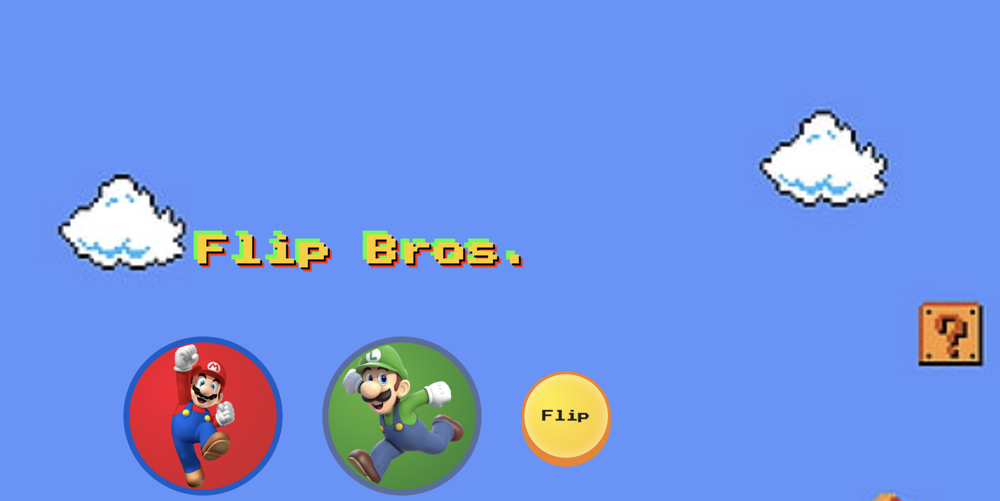

# 🎮 Flip Bros. — Mario vs Luigi Coin Flip

A nostalgic, game-inspired coin-flip built with a **Super Mario Bros.** twist.  
Choose your favorite bro, hit **Flip**, and watch the coin spin to reveal who wins — complete with character-themed coins, glowing animations, and power-up sound effects.

[Link to project](https://node-coin-flip-production.up.railway.app/)  

---

## How It’s Made:
**Tech used:** HTML, CSS, JavaScript, Node.js  

The project uses a simple local Node server to serve static files and handle an `/api` route that randomly returns either *Mario* or *Luigi*.  
The frontend listens for button clicks, spins a dynamic coin, swaps in the correct character image, and plays the **Super Mario 3 Power-Up** sound when flipping.

---

## Optimizations
- Add multiple sound effects (win / lose / power-up variants)  
- Include a flip counter and win streak tracker  
- Add themed background transitions or pixel-art confetti  
- Introduce touch-friendly gestures for mobile players  

---

## Lessons Learned
- How to route static assets (images, audio, CSS, JS) through a Node server  
- Managing animation timing and class toggles for smoother coin flips  
- Integrating short .wav audio clips without breaking game flow  
- Refining button layouts and CSS transitions for a retro aesthetic  

---
