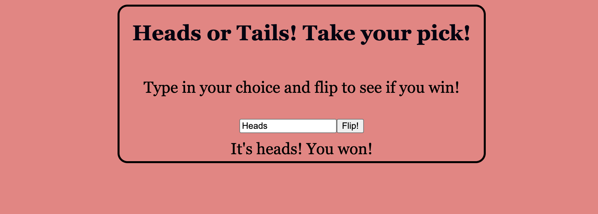

# Node Coin Flip Game

A heads-or-tails guessing game. Pick heads or tails, flip the coin, and see if you win — with the flip decided on the server.

Live demo: https://coin-flip-ukdu.onrender.com/



## What it does

- Type `heads` or `tails` and click Flip.
- The server flips a coin with `Math.random()` and returns the result as JSON (`GET /flip?choice=…`).
- The page tells you the result and whether you won or lost.

## Tech stack

- Node.js — plain `http` and `fs` modules, no framework
- HTML, CSS, vanilla JavaScript
- figlet (for the 404 page)

## How to run it

```bash
npm install
node server.js
```

Open http://localhost:8000. There is no `npm start` script in this repo — run `node server.js` directly.

## Project structure

```
server.js            - Node http server (port 8000), /flip endpoint, serves the page
index.html           - the game page (input, Flip button, result)
js/main.js           - sends your choice to /flip and shows the result
css/style.css        - page styling
package.json         - dependencies (figlet)
```

---

Thay Brown — thaybrown22@gmail.com · https://thaythecoder.netlify.app · https://github.com/tbrown320 · https://www.linkedin.com/in/thaybrown
