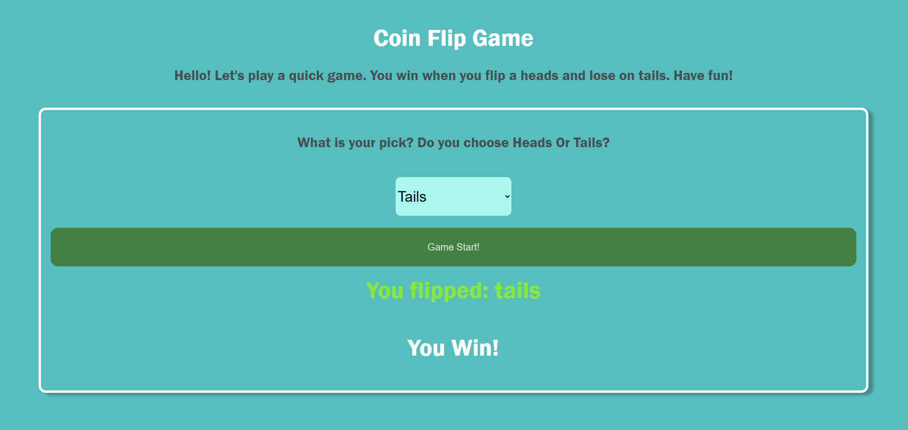

# Coin Flip Game

# Description
This website enables user to guess if the coin flip will be heads or tails. The server will generate a result and display the game outcome on the screen.

## How It's Made:
Tech used: 
- HTML
- CSS
- JavaScript
- Node.js
- API

## How to Use:
To use this coin game, follow these steps:

Clone the repository: git clone https://github.com/WinnieYuDev/node-coin-flip.git
Navigate to the app directory in terminal: cd app
Install dependencies in terminal: npm install
Run the server by pasting this into the terminal: node server.js
Open your browser and navigate to http://localhost:2000/

## Lessons Learned:
- Creatomg my own API through vs code
- Using a server to generate a response
- Learning how to use Node.js and create servers

